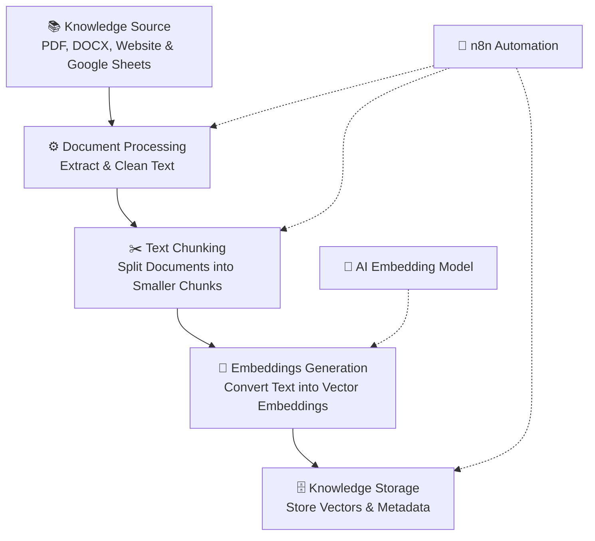
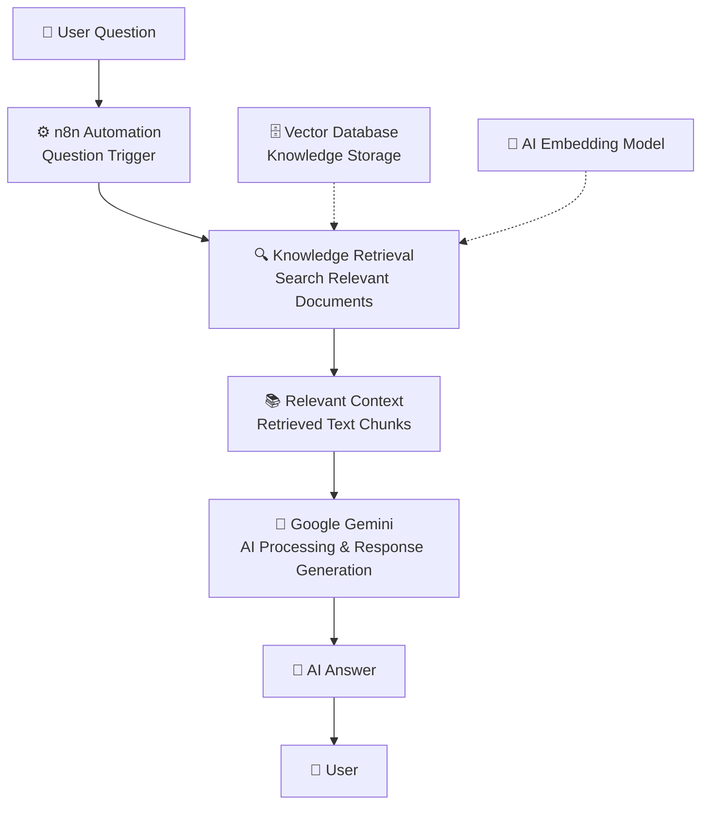
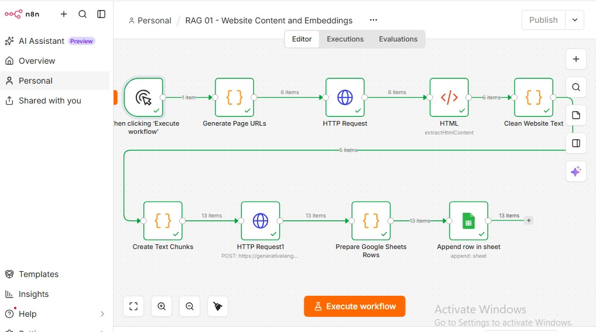
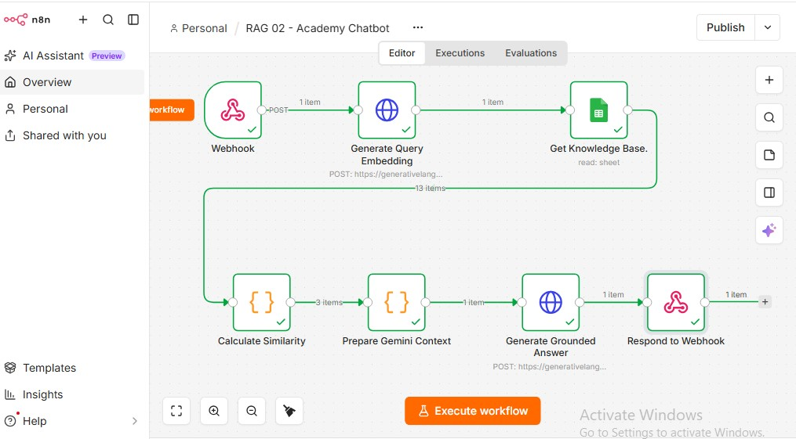

# 🧠 RAG Knowledge Base Chatbot

> AI-powered knowledge base chatbot built with **n8n, Google Gemini, RAG, embeddings, and vector-based information retrieval.**

---

## 📌 Project Overview

This project is an AI-powered **Retrieval-Augmented Generation (RAG) Knowledge Base Chatbot** designed to answer user questions using information stored in a knowledge base.

Instead of relying only on general AI knowledge, the system retrieves relevant information from the connected knowledge source and provides it to the AI model as context before generating the final answer.

The automation and AI workflow is orchestrated using **n8n**, with **Google Gemini** used for AI-powered response generation.

---

## 🎯 Business Problem

Businesses often store important information across documents, FAQs, and internal knowledge bases.

Customers and employees may struggle to quickly find the information they need, while support teams spend significant time answering repetitive questions.

This can lead to:

- Slow customer support
- Repetitive manual responses
- Difficulty finding information
- Inconsistent customer experiences
- Increased support workload

---

## 💡 Solution

I developed a RAG-based AI chatbot that retrieves relevant information from a knowledge base and uses Google Gemini to generate context-aware answers.

The complete process is automated through n8n.

The system allows users to ask questions in natural language and receive answers based on the available knowledge.

---

## ⚙️ How It Works

## ⚙️ RAG Workflow Architecture

### Knowledge Processing

The following diagram illustrates the complete AI-powered knowledge base workflow, from collecting knowledge sources to processing, embedding generation, and storing information for AI-powered retrieval.

### Workflow Components

1. **Knowledge Source:** Collect data from PDFs, DOCX files, websites, and Google Sheets.
2. **Document Processing:** Extract and clean text from the collected documents.
3. **Text Chunking:** Divide large documents into smaller, manageable text sections.
4. **Embeddings Generation:** Convert text chunks into numerical vector representations using an embedding model.
5. **Knowledge Storage:** Store text chunks, embeddings, and metadata in a vector database or knowledge store.

**Purpose:** This RAG ingestion pipeline prepares external knowledge for AI-powered search, retrieval, and question answering.

### Question Answering

## 🤖 RAG Workflow – AI Question Answering

The following diagram illustrates how a user submits a question, n8n retrieves relevant information from the knowledge base, and Google Gemini generates an AI-powered answer.

### Workflow Components

1. **User Question:** User submits a question through a chat interface.
2. **n8n Automation:** Receives the question through a Chat Trigger or Webhook.
3. **Knowledge Retrieval:** Searches the knowledge base for relevant information.
4. **Relevant Context:** Retrieves the most relevant text chunks.
5. **Google Gemini:** Analyzes the question and retrieved context to generate an answer.
6. **AI Answer:** Returns a context-based response to the user.
7. **User:** Receives the final AI-generated answer.

**Purpose:** This RAG retrieval pipeline enables an AI chatbot to answer user questions using information from your own knowledge base.

---

## 🔄 Workflow Architecture

1. Business information is prepared for the knowledge base.
2. The information is divided into smaller chunks.
3. Embeddings are generated for the knowledge content.
4. The knowledge is stored for retrieval.
5. A user submits a question.
6. n8n receives the question.
7. The system searches for relevant information.
8. Relevant context is retrieved.
9. Google Gemini uses the retrieved context to generate the answer.
10. The chatbot returns the response to the user.

---

## ✨ Key Features

- 🤖 AI-powered question answering
- 🧠 Retrieval-Augmented Generation (RAG)
- 📚 Knowledge-base-based responses
- 🔎 Relevant information retrieval
- 💬 Natural-language questions
- 🧩 Context-aware AI responses
- ⚙️ Automated n8n workflow
- 📈 Scalable automation architecture

---

## 🛠️ Technologies Used

| Technology | Purpose |
|---|---|
| **n8n** | Workflow automation and orchestration |
| **Google Gemini** | AI response generation |
| **RAG** | Retrieval-Augmented Generation |
| **Embeddings** | Semantic representation of knowledge |
| **Vector Search** | Relevant information retrieval |
| **Knowledge Base** | Source of information for AI responses |

---

## 📊 Workflow Components

### 1. Knowledge Processing

The knowledge source is processed and divided into manageable chunks.

### 2. Embedding Generation

The text chunks are converted into embeddings so the system can perform semantic retrieval.

### 3. Knowledge Storage

The processed information and embeddings are stored so they can later be searched.

### 4. Question Processing

When a user asks a question, n8n receives and processes the request.

### 5. Context Retrieval

The system searches the knowledge base and retrieves information relevant to the user's question.

### 6. AI Response Generation

Google Gemini receives the retrieved context and generates a context-aware answer.

### 7. Response

The generated answer is returned to the user.

---

# 📸 Workflow Screenshots

## Complete RAG Workflow

The n8n workflow processes knowledge, generates chunks and embeddings, and prepares the knowledge base for retrieval.

.png)

---

## Knowledge Processing

Example of the successful knowledge processing workflow.

---

## Stored Knowledge

Processed chunks and embeddings stored for retrieval.

.png)

---

## User Question & AI Answer

The chatbot receives a customer question and generates an answer using retrieved knowledge.

.png)

---

## Successful Question Answering

Example of the completed question-answering workflow.

---

# 💼 Business Benefits

This automation can help businesses:

- ⚡ Access information faster
- 📉 Reduce repetitive support tasks
- 🎯 Provide more relevant AI responses
- 😊 Improve customer experience
- 🧠 Make organizational knowledge easier to access
- 🔄 Automate repetitive question-answering processes

---

https://github.com/syedaliabbashamdani/rag-knowledge-base-chatbot/blob/98041afb12622d0c0b06bd3bf44de242936a5c74/docs/PROJECT-WALKTHROUGH.md

# 👨‍💻 My Role

I designed, configured, and tested the automation workflow using n8n.

My work included:

- Designing the RAG workflow
- Configuring knowledge processing
- Working with embeddings
- Configuring information retrieval
- Integrating Google Gemini
- Connecting the automation components
- Testing the question-answering process

---

# 🚀 Project Status

**Completed ✅**

### Project Category

`AI Automation` · `RAG` · `AI Chatbots` · `n8n Workflow Automation`

---

# 💡 What I Can Build

I can build custom AI knowledge-base and automation systems that connect business information with AI models and automation platforms.

Typical use cases include:

- Customer support
- Internal knowledge assistants
- FAQ automation
- Document-based AI assistants
- Business knowledge systems
- AI-powered help desks

---

## 📬 Interested in a Similar Automation?

If your business has repetitive questions or large amounts of information that are difficult to manage manually, an AI knowledge-base automation can help make that information easier to access.
